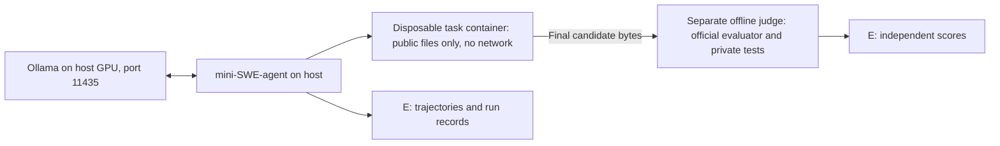

# CSC2108 local mini-SWE-agent baseline (Condition A)

**Status on 2026-11-16:** models, Docker disks, caches, and artifacts are on E:. Qwen3.5 9B and Qwen2.5-Coder 14B passed the controlled coding task; Qwen2.5-Coder 7B failed it. The fixed nine-run pilot is complete: Qwen3.5 passed 1/3 official evaluations, 14B passed 0/3 and 7B passed 0/3. Seven failures were official wrong answers and one had no submission. Format errors and logged context truncation limit interpretation. See [RESULTS.md](RESULTS.md) for measured outcomes and preserved failures.

The existing `orchestration_pilot` and `timeline` are unchanged. This directory implements only A; it does not import their frontier adapters, call paid providers, or contain benchmark reference solutions.



## Local installation

Run PowerShell from this directory. Python 3.11.9 is already available on this machine.

```powershell
. .\env.ps1
uv venv --python 3.11 E:\CSC2108Local\.venv
uv --system-certs pip sync --python E:\CSC2108Local\.venv\Scripts\python.exe requirements.lock
$python = 'E:\CSC2108Local\.venv\Scripts\python.exe'
uv pip check --python $python
```

`requirements.in` records the direct constraints; `requirements.lock` pins all 84 installed distributions for this Windows/Python environment. Mini-SWE-agent is 2.4.6. Pydantic 2.14.3's native wheel and LiteLLM 1.109.1's native bridge were blocked by Windows Smart App Control. Compatible releases Pydantic 2.12.5 / core 2.41.5 and LiteLLM 1.81.16 import successfully. Security settings were not changed. `--system-certs` uses Windows' trusted certificates; the initial uv request failed with UnknownIssuer.

The virtual environment, Python/download caches, temporary files, Hugging Face cache, model weights, dataset rows, vendor checkout, and run artifacts are on E:. The existing Python interpreter and installed Ollama/Docker binaries remain in their original locations.

## Ollama storage and startup

The account's persistent `OLLAMA_MODELS` is `E:\OllamaModels`. The dedicated project server uses **127.0.0.1:11435**, with cloud inference disabled and pruning disabled. Initially the tray server on 11434 retained its old C: configuration because automatic approval review rejected stopping it. During the user's later storage recheck, the app's saved empty subfolder `E:\OllamaModels\ollama` was corrected to `E:\OllamaModels` and the idle app restarted. Both endpoints now see the same three models and pass fresh inference checks. Existing C: weights were left untouched. See [MODEL_LOCATIONS.md](MODEL_LOCATIONS.md) for exact paths and access details.

```powershell
. .\start_ollama.ps1
. .\env.ps1
$python = 'E:\CSC2108Local\.venv\Scripts\python.exe'
& $python inventory.py
```

Inspect `E:\CSC2108Local\logs\ollama-project.stderr.log`: its startup configuration must show port 11435 and `OLLAMA_MODELS:E:\\OllamaModels`. `inventory.py` checks that configuration, verifies the E: directory, matches all model manifests to existing blobs and their declared byte sizes, and writes `E:\CSC2108Local\artifacts\environment.json`. Ollama itself verifies download digests. Model files were never moved or deleted.

Only if weights are missing, and after verifying the startup storage, pull sequentially:

```powershell
foreach ($model in @('qwen3.5:9b', 'qwen2.5-coder:14b', 'qwen2.5-coder:7b')) {
    $body = @{model=$model; stream=$false} | ConvertTo-Json
    Invoke-RestMethod -Method Post http://127.0.0.1:11435/api/pull `
        -ContentType application/json -Body $body -TimeoutSec 1200
}
& $python inventory.py
```

Tags can change upstream. The measured full digests are in RESULTS.md and environment.json; a reproduction must check the digest, rather than assume the same tag is identical.

## Connection checks (no command execution)

```powershell
& $python probe.py --model qwen3.5:9b --protocol text --output E:\CSC2108Local\artifacts\new-probe-35
& $python probe.py --model qwen2.5-coder:14b --protocol text --output E:\CSC2108Local\artifacts\new-probe-14
& $python probe.py --model qwen2.5-coder:7b --protocol text --output E:\CSC2108Local\artifacts\new-probe-7
```

Each output directory must be new. Probes query the actual framework model adapter and parser, save the full prompt/response, and never dispatch the produced command. They unload only the three approved models on the dedicated project endpoint before each check. The original server is unaffected. Avoid concurrent use of the dedicated endpoint during experiments.

Initial native-tool probes succeeded for Qwen3.5 and failed for both Qwen2.5 models, which emitted JSON as content. The first minimal text prompt also caused malformed code fences for 9B and 7B. The common `explicit-fence-v2` prompt added a literal multiline command example and newline instructions; all three passed connection probes. On the repair task, 7B repeatedly emitted multiple command blocks. The current common `single-step-v3` profile adds one-step-at-a-time/noninteractive-editing instructions and explicit format-error feedback. Every model was rerun with v3 before the pilot; 7B then executed 20 valid actions but produced invalid Python. All earlier failures are retained. The stock text parser/regex is unchanged. The runner defaults to the same v3 text interface for every model; `--protocol native` is an explicitly different configuration. These workflow clarifications contain no task-specific algorithm or repair advice.

All models use temperature 0, seed 2108, 8,192 context tokens and 2,048 generated tokens per response. Qwen3.5 uses `think=false`; the two Qwen2.5 models have no thinking override. No model-call retries are enabled. These are pilot settings, not a claim of bitwise reproducibility or optimal Qwen sampling.

## Docker storage and containment

The Docker data disk was originally:

`C:\Users\<USER>\AppData\Local\Docker\wsl\disk\docker_data.vhdx` (user name redacted in pass 3)

Its length was 10,205,790,208 bytes. After explicit user approval, Docker Desktop 4.71's own relocation interface moved the data disk and control distro to `E:\DockerDesktop`. A checksum-verified pre-move backup is retained under `E:\CSC2108Local\backups\docker-before-relocation-20261116`. Images and volumes were compared before and after; the existing Open WebUI container was preserved and resumed. The relocation used the installed UI's `/app/settings` interface with `vm.resources.wslDataFolder`; the effective setting and WSL registry base path were verified afterward. No registry paths were manually rewritten and no junction was used.

The account's newly created `.wslconfig` also sets `swapFile=E:\\CSC2108Local\\wsl-swap.vhdx`; the actual swap VHDX exists on E: after a controlled WSL restart. This applies to all WSL 2 distributions; Docker was the only installed/running distro inspected. Default memory, CPU and swap-size settings were preserved.

For a different machine, use Docker Desktop **Settings → Resources → Advanced → Disk image location** and preserve existing contents. For this WSL backend, inspect **CustomWslDistroDir**, rather than the separate Hyper-V `DataFolder` setting. Verify storage before pulling anything:

```powershell
$settings = Get-Content "$env:APPDATA\Docker\settings-store.json" -Raw | ConvertFrom-Json
$dockerDiskRoot = $settings.CustomWslDistroDir
if (-not $dockerDiskRoot -or -not $dockerDiskRoot.StartsWith('E:\')) { throw 'Docker data is not on E:' }
$disks = Get-ChildItem -LiteralPath $dockerDiskRoot -Recurse -Filter *.vhdx
if (-not $disks) { throw 'No Docker VHDX found at the configured E: location' }
$disks | Select-Object FullName,Length
docker info
docker pull python:3.11-slim-bookworm
```

The runner requires Linux Docker with memory/PID limits, an E: `CustomWslDistroDir` matching `--docker-disk-root`, a VHDX there, and a locally present image. It never pulls images automatically. Exact image IDs/digests are saved with runs. Earlier storage refusals remain recorded as infrastructure errors with zero dispatched actions. Run the trusted containment check with `& $python validate_isolation.py`; it verifies resource/mount settings, read-only root behavior, fixture failure feedback, independent rejection of the wrong candidate, and container termination on a long command.

## Run the controlled repair task

Once Docker storage and its daemon are verified:

```powershell
& $python runner.py --model qwen3.5:9b --docker-disk-root $dockerDiskRoot
& $python runner.py --model qwen2.5-coder:14b --docker-disk-root $dockerDiskRoot
& $python runner.py --model qwen2.5-coder:7b --docker-disk-root $dockerDiskRoot
```

The fixture contains an incorrect signed-sum implementation and three visible unittest cases. The prompt requests inspection, a failing test before editing, a repair, another test, and explicit submission. Qwen3.5 demonstrated that full sequence with both v2 and v3. The 14B model demonstrated it with v2 and passed correctness with v3, although its v3 run did not produce a recognized initial failed test. The 7B model failed with both profiles. Independent evaluation, not the submission sentinel, determines correctness.

Every task runs as UID 65534 in a disposable Linux container with network disabled, a read-only root, all capabilities dropped, no-new-privileges, one CPU, 512 MB RAM without swap, and 64 PIDs. Only the dedicated public task directory is mounted, read-only. `/workspace` is a fresh 64 MB tmpfs; `/tmp` is a 32 MB tmpfs. Neither the repository root nor the evaluator, private dataset cache, user home, credentials, or Docker socket is mounted. The model client remains on the host and talks to Ollama. Model commands never execute through a host shell.

Commands have a 27-second inner process-group timeout and a 30-second outer Docker timeout. Output files have a 1 MB file-size limit and returned output is capped at 16 KB. Timeout/execution errors terminate the task container. Only a regular, non-symlink `solution.py` of at most 1 MB is extracted as data. Independent fixture evaluation uses a new container, pristine public tests and three additional arithmetic cases. Generated Python is never executed on Windows.

## Agent loop, budgets, and records

Mini-SWE-agent `DefaultAgent` renders system/task messages, queries its model adapter, parses actions, calls the environment and appends observations to its full conversation history. It saves a trajectory after every step, including format errors. There is no context summarization. Client-side context errors stop the run; the effective model context remains capped at 8,192 tokens, so server-side truncation must also be checked in Ollama's saved log. A successful completion sentinel raises `Submitted`. Step limits, repeated format errors, wall-time checks and exceptions also stop the loop. The installed v2 package labels its serialized format `mini-swe-agent-1.1`; this is upstream's trajectory-format identifier, not a v1 installation.

Small extensions add bounded model-call timeouts, action and repair accounting, safe Windows container cleanup, and independent evaluation. Upstream source files were not edited. Exact templates and inference settings are saved in configuration/trajectory files. The instance template `{{task}}` is the future context-injection boundary; no guidance generation or frontier API integration is implemented.

Defaults apply equally to all three models:

| Limit | Meaning |
| --- | --- |
| 20 actions | Each dispatched shell action counts, including submission and unsuccessful commands. Multiple tool calls count individually. |
| 25 model calls | Additional ceiling of actions + 5; malformed responses consume model calls but dispatch no actions. Three consecutive format errors stop the upstream loop. |
| 3 repairs | First observed source change after a recognized failed public test starts a repair. Further edits belong to it until a changed candidate is retested. Retesting unchanged failed code does not start another repair. |
| 600 seconds | Agent deadline, including setup, inference and shell actions; model calls get at most 120 seconds and the remaining budget. Independent post-run evaluation is separate. |

Only the exact standalone command `python -I /public/check.py` is a **recognized** public test for repair accounting. Other shell test commands remain visible in the trajectory but do not count as recognized tests. This operational restriction is in every prompt. Source changes are detected after execution; an attempted fourth repair terminates the run and preserves the candidate from before that action as the submission, while retaining the attempted action in evidence. Edits before the initial failed test do not count as repairs. This is a pilot definition to validate with real trajectories before freezing a main experiment.

Runs go to `E:\CSC2108Local\artifacts\runs\<id>`:

- `trajectory.json`: full upstream messages, raw model responses, actions, observations, termination and configuration.
- `configuration.json`, `task.json`: exact initial setup and permitted statement.
- `result.json`: identity, source/task/image/model provenance, commands, failures, repairs, wall time, independent evaluation and post-run GPU/VRAM snapshots.
- `solution.py`: extracted candidate, including on budget termination when available.

An infrastructure failure before agent creation has a result record and no trajectory. Probe timings are connection timings, not coding performance. GPU readings are post-inference/post-run snapshots, not measured peaks. Framework cost fields use zero bookkeeping for local inference and do not measure electricity or hardware cost.

## Reproduce the fixed LiveCodeBench pilot

Preparation is complete at `E:\CSC2108Local\lcb-v1`. `lcb_manifest.json` freezes dataset revision, source SHA256, public bundle hashes, evaluator commit and three task IDs: `atcoder-abc301_a` (easy), `atcoder-abc301_c` (medium), `atcoder-abc301_e` (hard). Selection was deterministic by platform/ID within difficulty, before coding runs. These older tasks are infrastructure checks; no contamination-free capability claim follows from this pilot.

To reproduce data preparation into a new directory:

```powershell
& $python prepare_lcb.py --output E:\CSC2108Local\lcb-v1-recreated
```

The official dataset's `release_v1` maps to `test.jsonl`. It was read directly at a pinned Hugging Face revision because current `datasets` versions do not support the old script-loading interface. The 1.25 GB raw file and raw selected private rows are on E:, never Git. Complete question statements and public tests are exported by an explicit allowlist. Private fields are saved only in the sibling `evaluator_private` directory. Exporting private pickle payloads does not deserialize them on the host.

The official evaluator checkout is pinned at `28fef95ea8c9f7a547c8329f2cd3d32b92c1fa24` in `E:\CSC2108Local\vendor\LiveCodeBench`. After Docker storage is corrected, build the small judge image:

```powershell
. .\build_judge.ps1
& $python validate_judge.py
& $python pilot.py --docker-disk-root $dockerDiskRoot `
    --smoke-result E:\CSC2108Local\artifacts\runs\REPLACE_WITH_PASSING_SMOKE_ID\result.json
& $python summarize.py E:\CSC2108Local\artifacts\pilots\REPLACE_WITH_NEW_BATCH_ID
```

The gate requires a submitted signed-sum run with recognized failed-then-passing public tests and independent correctness. The pilot runs the same three problems for each model with the same text prompt/budgets, in fresh environments. It validates frozen task hashes and the clean evaluator revision. Public development feedback uses whitespace-token comparison and is not an official score. After each agent terminates, a different offline container invokes the pinned official `evaluate_generations_by_problem` on its submission and the public/private test sample. Private decoding (with a data-only unpickler), evaluator code and all private results stay outside agent execution. Judge image resources are capped; no official untrusted-code evaluator runs on the Windows host.

The judge image and evaluator adapter passed synthetic correct/wrong/syntax/timeout and encoded-private-test checks in live offline containers. `build_judge.ps1` exports public Windows CA certificates into an E: build context, maintaining TLS verification; the first direct pip build failed because the base image lacked that trust. The image's base digest and all judge dependencies are pinned. The completed batch is `E:\CSC2108Local\artifacts\pilots\20261116T121253-720e27b2`, with unchanged implementation hashes across all nine runs. `metrics.csv`, `summary.json` and the copied `ollama-server.log` accompany its individual trajectories and official scores. Missing submissions count as failures in the denominator of three tasks per model; there were no infrastructure-error results in this batch. The server log contains context-truncation events. A single sample per problem is a descriptive pilot, not a statistically meaningful model ranking.

## Checks performed

```powershell
& $python -m unittest -v test_runner
& $python -m py_compile runner.py probe.py prepare_lcb.py pilot.py judge_lcb.py inventory.py
& $python -m unittest discover -s ..\orchestration_pilot -v
```

Six new checks cover action limits, repair counting, container arguments, early storage refusal and private/public export separation. All four existing orchestration tests also pass. A real probe was run for each model/protocol configuration; see RESULTS.md. Running `pilot.py` against the blocked smoke result correctly exits before inference.

## Official references

- [mini-SWE-agent repository](https://github.com/SWE-agent/mini-swe-agent), [local model interfaces](https://mini-swe-agent.com/latest/models/local_models/), [v2 migration](https://mini-swe-agent.com/latest/advanced/v2_migration/).
- [Ollama Windows storage](https://docs.ollama.com/windows), [9B tag](https://ollama.com/library/qwen3.5:9b), [14B tag](https://ollama.com/library/qwen2.5-coder:14b), [7B tag](https://ollama.com/library/qwen2.5-coder:7b). The 9B page exposes multiple current variants; the actual installed GGUF digest/quantization is the evidence for this run.
- [Docker WSL storage](https://docs.docker.com/desktop/features/wsl/), [Desktop settings](https://docs.docker.com/desktop/settings-and-maintenance/settings/).
- [LiveCodeBench](https://github.com/LiveCodeBench/LiveCodeBench), [pinned dataset](https://huggingface.co/datasets/livecodebench/code_generation_lite/tree/0fe84c3912ea0c4d4a78037083943e8f0c4dd505).
