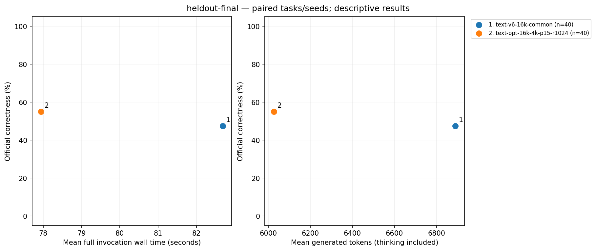
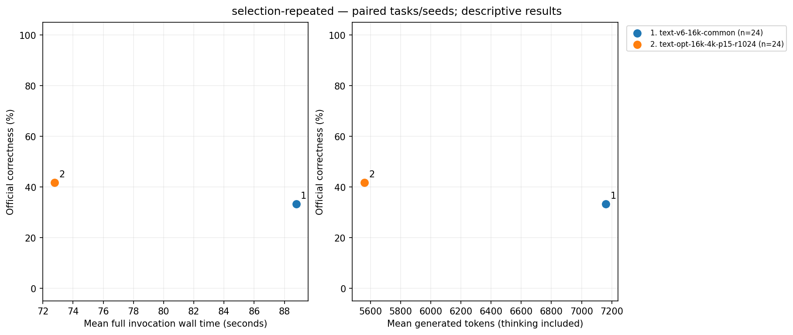
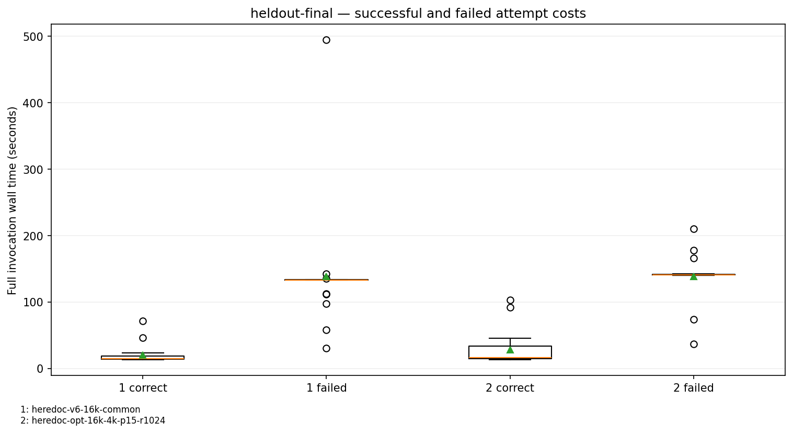

# Qwen3.5 9B local coding-agent optimization

Completed on 2026-11-17. **Recommended default: `heredoc-v6-16k-common`.** The challenger does not meet the preregistered confirmation rule. Retain the simpler original control as the practical default; no conclusive general accuracy improvement is claimed. All candidate-generating inference was local, all benchmark candidates were authored by Qwen, and official hidden outcomes were never returned to the agent. No frontier integration, model download, push or merge was performed.

## Final result

The fixed held-out evaluation contains 20 fresh problems and two seeds (2108/2109), 40 attempts per arm. The challenger changes presence penalty from 0 to 1.5 and its effective repetition window from 64 to 1024, retaining the original text protocol, nonthinking mode, 16K context, 4K output, T=.2, top_p=.9 and top_k=40. It also uses the documented checker-redirection accounting fix in the new runtime. This is an explicitly tested combined configuration, not an isolated causal estimate of either sampler change.

| Configuration | Passes | Agent seconds | Full wall seconds | Output tokens | Format errors |
| --- | ---: | ---: | ---: | ---: | ---: |
| `heredoc-v6-16k-common` | 19/40 | 3,213.1 | 3,307.3 | 275,593 | 59 |
| `heredoc-opt-16k-4k-p15-r1024` | 22/40 | 3,023.6 | 3,117.9 | 241,025 | 45 |

Challenger minus control: **+7.5 percentage points**, descriptive 95% problem-cluster bootstrap interval **[+0.0, +15.0]**; control-only passes 0, challenger-only passes 3. Runtime ratio 0.943; output-token ratio upper bound 0.875. Repetitions from the same problem remain together in 10,000 bootstrap resamples, RNG seed 2108. These are small-sample descriptive intervals, not proof of equivalence or general superiority. Held-out outcomes were used only for the frozen confirmation/fallback rule, never for further tuning.

The point estimates favor the challenger: full wall falls by 5.7%, output tokens by 12.5%, and format errors from 59 to 45. It is the descriptive Pareto winner. It nevertheless fails **two frozen promotion criteria**: the accuracy interval touches zero rather than having a strictly positive lower bound, and missing submissions increase from 8 to 9. Cost criteria pass. Retaining the control follows the decision made before validation; it does not establish that the challenger is worse. The alternative remains available through `selected.py --challenger`.

| Held-out difficulty | Original control | Challenger |
| --- | ---: | ---: |
| easy | 12/12 | 12/12 |
| medium | 7/16 | 9/16 |
| hard | 0/12 | 1/12 |

The same weights, hardware, prompt and action limits were used. Captured generation rates are 102.5 versus 96.4 tokens/s. The measured savings therefore chiefly reflect different generated work and trajectories, rather than a faster inference engine. Officially successful recoveries after a visible failure rise from 1 to 4, while delivery failures remain substantial. The three unmatched successes are on three problems; the sample does not establish a general improvement.

## Original baseline and observed limitations

The prior frozen evaluation reported Qwen3.5 9B 23/48 (47.9%), Qwen2.5-Coder 14B 18/48 and 7B 15/48 on 24 problems/two attempts. Only Qwen3.5 9B was used in this new study. Its prior breakdown was easy 14/16, medium 9/20, hard 0/12. Prior performance must not be compared as a causal before/after percentage against the new, different task set.

The original control uses mini-SWE-agent 2.4.6 → LiteLLM 1.81.16 → project Ollama 0.40.16 at 127.0.0.1:11435 → Qwen3.5:9b Q4_K_M. It permits 20 actions, three recognized public-failure repair groups, 600 seconds per task and 180 seconds per request. It executes the original archived `local_eval_v2/runtime.py`; all old source files and frozen results remain untouched.

Auditing all 48 prior Qwen9 attempts found 56 format errors, all on length-limited replies with an unclosed command fence. Exact boundary reconstruction separates **50 output-cap events from six context-cap events**; treating all as 4K output truncations would be incorrect. Twenty runs had format errors, 14 terminated with repeated-format failure and 12 executed no actions. Eight lacked a submission and four retained an unchanged starter. Six candidates passed public examples but failed official tests. Public recovery produced only one official success. Failed attempts consumed 288,284/299,459 generated tokens (96.3%) and most of 3,727.5 agent seconds. These observations distinguish interface/capacity failures from incorrect algorithms.

Repeated identical-source public tests occurred only five times. None of 29 runs ever passing public examples modified source after its first pass; 30 subsequent actions were mostly submission. This did not justify checkpointing, automatic acceptance of public tests, more actions, history summarization or a larger rewrite. They were not silently added.

## Methodology and isolation

The frozen dataset uses LiveCodeBench v6 Jan–Apr 2025, cached source SHA256 `bb4c364f71921c4495a6ad15abe1a927350b720009f4933e2e71f8af0f6fd1f5`, revision `0fe84c3912ea0c4d4a78037083943e8f0c4dd505`. Development 6 (2 easy/2 medium/2 hard), selection 12 (4/4/4), held-out 20 (6/8/6) were selected before new inference by deterministic hash ordering and platform balancing. All splits exclude all 27 previously scored IDs; splits have disjoint contests, at most two tasks per contest, and held-out excludes prior primary-evaluation contests. Existing interface eligibility excludes custom-node functional interfaces and image statements. Manifests contain exact hashes and exclusions. Task outcomes did not select the held-out sample.

Each batch freezes source bytes, exact profiles, software packages, weights digest, dataset hashes, Docker image IDs and evaluator revision. Execution uses archived code, rotates arm order and interleaves difficulty; GPU runs are sequential under the shared lock. Captured HTTP requests verify all sampler/thinking/model settings. Raw requests, responses, trajectories, public events, GPU samples, candidates and independent judge attempts remain on E:. Stopped arms keep every measured attempt and explicitly unstarted slots. Defined but unexecuted profiles in the catalog are not counted as experiments.

Agent containers use network:none, read-only root, nonroot 65534,512 MB memory/no extra swap, 1 CPU, 64 PIDs, all capabilities dropped, no-new-privileges and capped tmpfs. They mount only the trusted public bundle. Private cases are supplied only to the separate official judge (1 GB/1 CPU, 6 seconds per test, 175 second container guard/180 second host timeout). Source extraction is byte-based with size/symlink guards; candidate code never executes on the Windows host. Only owned containers are cleaned; unrelated Docker/Ollama workloads are preserved.

## Engineering findings

**Native history:** the installed LiteLLM serializer omits native assistant tool calls and tool-result names. A mocked real HTTP transport test reproduces it. The versioned override in `transport.py` preserves assistant calls, arguments, linked results and reasoning without modifying installed packages, following [Ollama's protocol](https://docs.ollama.com/capabilities/tool-calling). Two synthetic fixtures reduce actions 9→5 and 15→8, output 679→297 and 910→450, all passing. Those are mechanism checks, not benchmark gains. Corrected native tools did not earn a default recommendation.

**Public-test accounting:** direct checker commands ending in `2>&1` are recognized in the new runtime; compound commands or pipelines masking exit status are not. Historical posthoc recognition is exported separately and does not rewrite original repair accounting. Public passes still do not establish private correctness.

**Timeouts:** LiteLLM can wrap httpx read timeouts as APIConnectionError. Typed cause/context traversal distinguishes timeout from connection refusal. Missing replies retain unknown token/duration bounds, conservatively charged at caps. An early raw InfrastructureError remains unchanged with a hash-linked timeout assessment rather than an invented complete response.

**Judge resource failures:** an official evaluator error was traced to an owned worker OOM under 1 GB. `judge_watch.py` preserves the raw official result and owned Docker OOM event, and classifies a confirmed resource violation as zero-pass candidate failure. A known Qwen toy and deliberate OOM fixture validate this. An older plan pins an explicit bookkeeping addendum; no candidate was edited and no inference repeated. Unknown infrastructure errors stop the batch.

**Long commands:** a 227,558-byte generic fixture reproduced WinError206 in Windows argv delivery. Optional binary-stdin transport preserves UTF8 bytes/SHA256, quoting and closed candidate stdin within the same sandbox; both final output-probe arms share it. It does not edit generated source. Short-output/default arms retain their original transport. The fixture is a transport test, never a benchmark solution.

## Adaptive development experiments

These small experiments use different development subsets; their success fractions are not pooled into a head-to-head leaderboard. All successes use the official evaluator. Output includes thinking. Unknown timeout work is marked explicitly.

### dev-general-thinking-protocol

| Configuration | Passes | Agent seconds | Full wall seconds | Output tokens | Format errors |
| --- | ---: | ---: | ---: | ---: | ---: |
| `native-general-128k-32k-think` | 0/1 | 602.1 | 604.5 | 48,922 + ≤32,768 unobserved | 0 |
| `heredoc-general-128k-32k-think` | 0/1 | 525.9 | 528.3 | 45,752 | 1 |

### dev-interface-thinking

| Configuration | Passes | Agent seconds | Full wall seconds | Output tokens | Format errors |
| --- | ---: | ---: | ---: | ---: | ---: |
| `heredoc-v6-16k-common` | 2/3 | 126.6 | unavailable | 9,259 | 2 |
| `native-fixed-16k-4k` | 2/3 | 267.5 | unavailable | 18,366 | 0 |
| `native-fixed-16k-4k-think` | 1/3 | 285.0 | unavailable | 25,841 | 6 |

### dev-native-context

| Configuration | Passes | Agent seconds | Full wall seconds | Output tokens | Format errors |
| --- | ---: | ---: | ---: | ---: | ---: |
| `native-opt-32k-4k-p15-r1024` | 0/1 | 224.2 | 226.5 | 16,019 | 0 |

### dev-nonthinking-large-output

| Configuration | Passes | Agent seconds | Full wall seconds | Output tokens | Format errors |
| --- | ---: | ---: | ---: | ---: | ---: |
| `heredoc-opt-64k-32k-p15` | 0/1 | 600.0 | 602.6 | 32,768 + ≤32,768 unobserved | 1 |

### dev-nonthinking-presence

| Configuration | Passes | Agent seconds | Full wall seconds | Output tokens | Format errors |
| --- | ---: | ---: | ---: | ---: | ---: |
| `heredoc-opt-16k-4k-p0` | 1/3 | 207.5 | 214.6 | 17,362 | 3 |
| `heredoc-opt-16k-4k-p15` | 2/3 | 176.0 | 183.2 | 14,189 | 3 |

### dev-output-budget

| Configuration | Passes | Agent seconds | Full wall seconds | Output tokens | Format errors |
| --- | ---: | ---: | ---: | ---: | ---: |
| `native-fixed-128k-4k-think-longquery` | 0/1 | 128.5 | 131.0 | 12,288 | 3 |
| `native-fixed-128k-32k-think` | 0/1 | 600.1 | 602.6 | 32,768 + ≤32,768 unobserved | 1 |

### dev-protocol-nonthinking-preset

| Configuration | Passes | Agent seconds | Full wall seconds | Output tokens | Format errors |
| --- | ---: | ---: | ---: | ---: | ---: |
| `heredoc-opt-16k-4k-p15-r1024` | 0/2 | 88.9 | 93.7 | 5,662 | 0 |
| `native-opt-16k-4k-p15-r1024` | 0/1 | 205.4 | 207.8 | 14,388 | 4 |
| `heredoc-opt-16k-4k-reason-r1024` | 2/2 | 226.9 | 231.7 | 18,040 | 0 |
| `native-opt-16k-4k-reason-r1024` | 0/1 | 172.9 | 175.4 | 12,136 | 0 |

### dev-repeat-window

| Configuration | Passes | Agent seconds | Full wall seconds | Output tokens | Format errors |
| --- | ---: | ---: | ---: | ---: | ---: |
| `heredoc-opt-16k-4k-p15-r1024` | 0/1 | 51.3 | 53.6 | 3,985 | 0 |

### dev-thinking-repeat-window

| Configuration | Passes | Agent seconds | Full wall seconds | Output tokens | Format errors |
| --- | ---: | ---: | ---: | ---: | ---: |
| `native-general-128k-32k-think-r1024` | 1/1 | 305.7 | 308.1 | 26,233 | 1 |

### dev-thinking-sampling

| Configuration | Passes | Agent seconds | Full wall seconds | Output tokens | Format errors |
| --- | ---: | ---: | ---: | ---: | ---: |
| `native-fixed-128k-32k-think-p15` | 0/1 | 109.6 | 111.9 | 9,601 | 0 |
| `native-coding-128k-32k-think` | 0/1 | 602.1 | 604.5 | 43,210 + ≤32,768 unobserved | 1 |

The first paired protocol screen found native nonthinking2/3 versus control 2/3 at roughly twice the time; native thinking 4K fell to1/3 and failed to deliver actions on medium/hard. Simply raising output to32K prolonged repetition or timeouts. Presence1.5 helped one development case, but default window 64 limited its reach. Window1024 shortened a hard nonthinking failure from 134.4 seconds/12,288 tokens/no candidate to51.3 seconds/3,985 tokens/a wrong candidate. That fixes delivery, not hidden correctness.

The documented vendor thinking preset with window 1024 solved one development medium at 305.7 seconds/26,233 tokens after window 64 failed at 602 seconds; it was too expensive and did not generalize in selection. A vendor nonthinking preset (T1/top_p1/top_k40/presence 2/window 1024) won2/2 development cases over 0/2 for the current sampler, then lost that advantage on fresh selection. These reversals justify separate development and selection sets.

A native context16K→32K trial removed four real context cutoffs (generations1098/199/161/123 tokens each exactly filling16,384 combined tokens), reached over 18K prompt tokens and 20 actions, but remained incorrect. Capacity and reasoning are separate limitations. The final output-only probe fixes64K context and 480 second request/600 second task budgets across4K/32K outputs; its exact measured outcomes appear below. No further parameter/prompt exploration followed it.

| Configuration | Passes | Agent seconds | Full wall seconds | Output tokens | Format errors |
| --- | ---: | ---: | ---: | ---: | ---: |
| `heredoc-opt-64k-4k-reason-r1024` | 0/1 | 168.1 | 170.3 | 9,271 | 1 |
| `heredoc-opt-64k-32k-reason-r1024` | 0/1 | 151.7 | 154.1 | 12,701 | 1 |

The [Qwen model card](https://huggingface.co/Qwen/Qwen3.5-9B) motivated thinking and sampling hypotheses, including32K output. Recommendations were tested rather than assumed optimal. Presence is affected by its effective token window, as exposed by [Ollama's options](https://docs.ollama.com/modelfile) and [llama.cpp's sampler construction](https://github.com/ggml-org/llama.cpp/blob/master/common/sampling.cpp). A historical37-attempt match found equal23 passes under two older samplers, with three unique passes each; other provenance differences make that exploratory only.

## Fresh configuration selection and repeat

On the identical12 tasks/seed 2108, the four completed short-output arms give:

| Configuration | Passes | Agent seconds | Full wall seconds | Output tokens | Format errors |
| --- | ---: | ---: | ---: | ---: | ---: |
| `heredoc-v6-16k-common` | 4/12 | 859.9 | 889.0 | 72,343 | 13 |
| `heredoc-opt-16k-4k-p15-r1024` | 5/12 | 971.0 | 1,002.0 | 77,587 | 11 |
| `heredoc-opt-16k-4k-reason-r1024` | 4/12 | 1,134.6 | 1,163.3 | 88,565 | 20 |
| `heredoc-opt-32k-4k-reason-r1024` | 4/12 | 1,203.1 | 1,231.8 | 93,489 | 14 |

Presence-only, its tag-default counterpart and expensive thinking stopped after a balanced six-task prefix; 18 original-plan jobs remain explicitly unstarted. All six output-message sequences under presence-only/tag match, so rerunning their remaining cases offered little information. Costly thinking had1/6 versus control 1/6 at over twice the time. Larger-context vendor nonthinking did not improve correctness.

The control and best practical challenger were repeated on the same12 tasks with seed 2109. Combined seed 2108/2109 results:

The seed 2108 challenger uses archived runtime v3; seed 2109 and held-out use v4. The latter adds optional long-command delivery, disabled in this challenger, leaving its command path and sampler unchanged. Both retain the same checker-accounting behavior. Exact source archives and wire records preserve this provenance difference; the original control uses the unchanged v2 runtime throughout.

| Configuration | Passes | Agent seconds | Full wall seconds | Output tokens | Format errors |
| --- | ---: | ---: | ---: | ---: | ---: |
| `heredoc-v6-16k-common` | 8/24 | 2,073.2 | 2,130.8 | 171,860 | 31 |
| `heredoc-opt-16k-4k-p15-r1024` | 10/24 | 1,687.8 | 1,746.9 | 133,405 | 21 |

Selection Pareto frontier (accuracy, full wall and output tokens): `heredoc-opt-16k-4k-p15-r1024`. This is descriptive point dominance on identical coverage, not a significance claim. Full selection evidence was frozen before validation. No more expensive high-reasoning default is justified by the measured selection tradeoffs.

The seed 2109 comparison itself is preserved separately:

| Configuration | Passes | Agent seconds | Full wall seconds | Output tokens | Format errors |
| --- | ---: | ---: | ---: | ---: | ---: |
| `heredoc-v6-16k-common` | 4/12 | 1,213.3 | 1,241.8 | 99,517 | 18 |
| `heredoc-opt-16k-4k-p15-r1024` | 5/12 | 716.8 | 744.9 | 55,818 | 10 |

## Held-out efficiency, reliability and recovery

| Configuration | Prompt tokens | Generation seconds | Prefill seconds | Load seconds | Generated tokens/s | Offloaded runs |
| --- | ---: | ---: | ---: | ---: | ---: | ---: |
| `heredoc-v6-16k-common` | 372,705 | 2,687.6 | 38.2 | 127.7 | 102.5 | 0/40 |
| `heredoc-opt-16k-4k-p15-r1024` | 430,030 | 2,500.0 | 41.5 | 127.8 | 96.4 | 0/40 |

| Configuration | Successful agent median / p90 s | Failed agent median / p90 s | Full-wall median / p90 s |
| --- | ---: | ---: | ---: |
| `heredoc-v6-16k-common` | 12.8 / 25.6 | 130.7 / 133.1 | 64.9 / 133.6 |
| `heredoc-opt-16k-4k-p15-r1024` | 13.8 / 42.3 | 138.8 / 167.0 | 42.2 / 141.7 |

Agent elapsed covers preflight/cold loading/container setup through termination, excluding extraction/cleanup/judge. Full wall additionally includes interpreter startup, extraction, cleanup and telemetry; private judging stays separate. CSV/JSON retain min/p25/median/p75/p90/max and individual attempts, not just means. Prefill/load/generation come from actual completed Ollama responses; timeout totals explicitly expose missing work.

Offline judge wall totals are 54.1 seconds for control and 50.7 for challenger, with 40/40 and 40/40 timing observations. CSV also exports agent-plus-judge wall when both are available; the coding-agent Pareto comparison excludes offline judging. All judge-attempt time is included when a saved candidate needed a bookkeeping rejudge.

| Configuration | Model calls / actions | Format errors | Missing | Public recovery / official success after failure | Public pass, official fail | Output spent on failures |
| --- | ---: | ---: | ---: | ---: | ---: | ---: |
| `heredoc-v6-16k-common` | 178 / 119 | 59 | 8 | 2 / 1 | 4 | 260,472 (94.5%) |
| `heredoc-opt-16k-4k-p15-r1024` | 175 / 130 | 45 | 9 | 5 / 4 | 4 | 210,825 (87.5%) |

These results distinguish better delivery from stronger algorithmic reasoning. Fewer format errors or more submitted candidates alone do not establish correctness. Public recovery counts recognized direct checks, with historical posthoc events separately identified. Wrong candidates can pass examples; additional actions can spend substantial work without improving official outcomes. Full normalized metrics retain termination reasons, output/context boundary counts, unchanged starters and resource failures.

Held-out descriptive Pareto frontier: `heredoc-opt-16k-4k-p15-r1024`. Dominance requires identical task/seed coverage and a dominating arm's token upper bound no greater than the other's observed lower bound. No arbitrary composite score was used.

## GPU, storage and inference behavior

RTX 4080SUPER16,376 MiB, driver 610.88. Small-prompt allocation probes measured 32K: 6.718 GB, 64K: 7.683 GB and 128K: 9.897 GB model allocations, fully resident on GPU. The 128K probe used 13,262 MiB total including desktop/background. Allocation feasibility is not evidence of long-prefill throughput or an accuracy advantage. Sustained captured generation was typically90–105 tokens/s; exact final-arm rates appear above. GPU samples include unrelated desktop allocations, so are not process-exclusive memory measurements.

Every benchmark intentionally cold-loads the project model for consistency. Loads normally take 3.2–3.5 seconds; the first diagnostic 20.6 second outlier is retained. Keeping a model warm could help deployment latency, but no unmeasured warm-start saving is credited. Weights stay in `E:\OllamaModels`, raw artifacts in `E:\CSC2108Local\optimization`, Docker in `E:\DockerDesktop`; no new model was downloaded. Ollama Desktop 11434 is distinct from the project 11435 server, and foreign loaded models halt new runs.

## Reproduction and exact provenance

See [README](README.md), [frozen selection](final_selection.json), [recommendation](final_recommendation.json), [profiles](profiles.json), and [full machine/package/image provenance](results/provenance.json). Python 3.11.9; mini-SWE-agent 2.4.6; LiteLLM 1.81.16; Pydantic 2.12.5; Ollama 0.40.16. Model `qwen3.5:9b`, Q4_K_M digest `56671c2ab9385f9cfcb404638e32cd62d88e3501d44822208363c010179a3c90`. Official LiveCodeBench evaluator `28fef95ea8c9f7a547c8329f2cd3d32b92c1fa24`. Docker image IDs, installed adapter hash and all package versions are machine-readable. Native DLL pins remain intact; plotting packages are isolated under E: and do not modify inference dependencies.

From `local_optimization` in PowerShell, dot-source `..\local_baseline\env.ps1`, use `E:\CSC2108Local\.venv\Scripts\python.exe`, then `selected.py --task <trusted-public-bundle> --output <fresh-E-directory> --seed 2108`. `--challenger` explicitly selects the evaluated alternative. The entrypoint checks the selection/recommendation linkage, exact profile and source hashes; its default follows the frozen confirmation rule.

`batch.py --batch E:\CSC2108Local\optimization\batches\heldout-final --resume` skips completed inference/judging. `analyze.py`, `verify.py`, `cohort.py`, `plot.py` and `finish_report.py` regenerate aggregate artifacts without solving tasks or editing candidates. Repeating the study from scratch requires new E: experiment directories with the committed manifests, source/cache/image pins and identical seeds/constraints. Never overwrite frozen batches or use judged tasks as fresh held-out data.

## Final verification

All 203 measured benchmark attempts across 15 frozen batches pass the final source, wire, candidate and judge consistency checks. The 24 deliberately unstarted weak-arm jobs are explicit in the inventory; no required held-out or repetition job remains. Both derived comparisons verify their pointers to original attempts. All 240 audited original evidence files and both old source trees are unchanged. The final package inventory, model digest, Ollama version, image IDs and clean official-evaluator revision match their frozen pins.

The nine pre-validation tests and compilation pass. Real Docker controls reproduce the legacy long-command failure, preserve the streamed source bytes and stdin, pass a known Qwen fixture, and identify a deliberate OOM. The recommended CLI passes source/configuration/image guards, submits the existing synthetic fixture in three actions without format errors, and passes its independent official fixture judge. Resuming the completed held-out batch performs zero new jobs and preserves 543 evidence-file hashes. The PNG figures were visually checked; SVG/PDF exports are included. [Integrity](results/final_integrity.json), [tests](results/prevalidation_checks.json), [entrypoint acceptance](results/entrypoint_acceptance.json), [resume proof](results/resume_check.json).

## Experiment inventory and remaining limits

| Frozen batch | Completed / planned | Intentionally unstarted |
| --- | ---: | ---: |
| `dev-general-thinking-protocol` | 2/4 | 2 |
| `dev-interface-thinking` | 9/9 | 0 |
| `dev-native-context` | 1/1 | 0 |
| `dev-nonthinking-large-output` | 1/1 | 0 |
| `dev-nonthinking-presence` | 6/6 | 0 |
| `dev-output-budget` | 2/4 | 2 |
| `dev-protocol-nonthinking-preset` | 6/8 | 2 |
| `dev-repeat-window` | 1/1 | 0 |
| `dev-thinking-repeat-window` | 1/1 | 0 |
| `dev-thinking-sampling` | 2/2 | 0 |
| `heldout-final` | 80/80 | 0 |
| `selection-final-output-probe` | 2/2 | 0 |
| `selection-repeat-s2109` | 24/24 | 0 |
| `selection-s2108` | 42/60 | 18 |
| `selection-vendor-context-s2108` | 24/24 | 0 |

Total itemized conservative inference use is **5.395 hours and 1,753,525 output tokens**, under the 10-hour/3-million-token ceiling. The runtime-record gate charges 5.391692 hours/1,753,522 tokens, including the final synthetic entrypoint check and explicit missing-reply caps. Three separately saved one-token allocation probes add 10.7446001 seconds and 3 tokens; [their accounting](results/allocation_probe_accounting.json) pins the original record. No frozen gate, inference setting or result was altered. These are conservative charges, not a claim of complete measured timeout telemetry. Discovery stopped at 3.396 gate hours, preserving the validation reserve.

Complete trajectories, failed attempts and independent judge evidence remain on E:. Aggregate-only JSON/CSV and PNG/SVG/PDF charts are versioned here. [Experiment hashes](results/experiment_inventory.json) identify frozen plans and analyses. [Commit inventory before this final report](results/commits-before-report.txt) records scoped progress; `git log --reverse d0fb8756..HEAD` also includes the final report commit. [Changed-file inventory](results/changed-files.txt) lists the complete project diff. All changed project files are confined to `local_optimization/`; no baseline/eval-v2 files were changed. Branch: `feat/csc2108-qwen-local-optimization`. Nothing was pushed or merged.

The authorized study stages are complete. All 38 fresh benchmark problems have now been scored; [the future-exclusion list](results/scored_task_ids.json) records their union with the 27 previous IDs (65 total). Bootstrap clusters are problems rather than contests, so any within-contest dependence is another limitation. Remaining research questions include larger independent validation, model/dataset training contamination, sensitivity to seeds/contest mix, longer-input throughput, warm-start deployment latency and stronger algorithmic reasoning without excessive inference. Small samples, adaptive selection, one quantization/hardware combination and desktop/container noise limit generalization. Held-out 20 problems improve separation of tuning and validation but do not establish a population-wide model ranking. No new configuration may be tuned on these held-out outcomes; any follow-up needs fresh tasks. No expensive high-reasoning alternative is recommended from this evidence.
