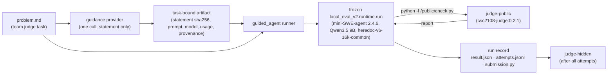

# Benchmark readiness: what to freeze for the full LiveCodeBench comparison

Status after the 2026-11-21/22 overnight pass. The full benchmark was **not** run.

## 1. Recommended architecture

* One coding backend for every local condition: the **unchanged frozen `runtime.run` bytecode**. Only the first-message template (guidance block) and the recognized public-test command (routed to judge-public) are rebound. Host differences come from `local_agent` (`windows` globals / `portable.adapted_run`).
* Guidance is generated **once**, before coding, from the public statement only, and stored as a write-once artifact replayed through `SavedPlan` / `SavedContract` (statement-hash bound). Generation latency/cost is recorded in the artifact, not in the local run's wall time.
* Public feedback comes only from Peter's judge-public. Hidden scoring is a separate command after all attempts, with only pass/fail and counts recorded.
* Peter's run-record handoff (`result.json`, `attempts.jsonl`, `submission.py`) is written for every attempt, plus host, model, judge and source provenance.

## 2. Configuration status

| Component | Status | Notes |
| --- | --- | --- |
| Integrated backend (`guided_agent`), original agent | **Ready** | Frozen hashes verified per attempt; sampler wire-verified; 18 offline tests; 100+ real attempts tonight without infrastructure failure |
| C — `plan-v1` (teammates' PlanSearch-inspired prompt) + `inject-v1` | **Ready** | Best-supported condition; plan form matters (see FINAL_REPORT §6) |
| D — `contract-v1` (teammates' contract prompt) + `inject-v1` | **Ready to run, not shown to help** | Contracts are accurate but do not supply what this agent lacks |
| Codex-authored replay (`codex exec`, isolated) | **Development only** | Useful and free; harness context differs from the API; label results as replay |
| Direct OpenAI API (`gpt-6.2-sol`, effort medium, 8,000 max completion tokens) | **Ready** | Ledger enforces request/$ ceilings; ~$0.008 per guidance request observed |
| aci-v2 (repeat guard + truncation message + unchanged-source note) | **Experimental** | Improved delivery on dev; see the mini-benchmark aci-v2 arm before promoting |
| aci-v1 (notes only) | **Do not promote** | Notes ignored; produced 20-action loops |
| contract-v2 (discriminating checks + "run them") | **Do not promote yet** | Checks were correct, but the coder never ran them |
| B (frontier-only), E (diagnosis), F (combined) | **Not integrated** | Use the same backend: E needs a hook after the first recognized failed judge-public call (the `JudgedEnvironment._public_judge` point), delivering one diagnosis as the next user message |

## 3. Remaining work before freezing the real benchmark

1. **Fix `judge/build_data.py` on Windows**: write test files with `newline=''` (LF). Windows builds currently fail the manifest hashes. `guided_agent.tasks` works around this without editing the judge.
2. **Decide the agent configuration once**: either the original frozen agent, or aci-v2 promoted with its own fresh validation. Never mix the two within a comparison.
3. **Task pool.** `test6` has 0 fresh easy and 2 fresh medium AtCoder tasks outside the manifests and the 75-ID union, and 28 previously scored IDs are already in the main manifest. Re-examine the main cohort's freshness, or add a newer pinned shard. Only stdin/stdout tasks are supported by the judge.
4. **Python versions**: the agent sandbox runs 3.11 (frozen) and the judge runs 3.12. Keep this fixed and recorded, or move both together.
5. **Mac**: run the native validation in `PORTABILITY.md` §8 and keep Mac results a separate hardware cohort.
6. **Implement B and E** on the same backend before the main run. F remains optional.

## 4. How to run the full A/B/C/D/E comparison without confounds

* **Same tasks, same agent, same budgets.** 20 actions, 3 repair groups, 600 s, 180 s per model request, seed fixed per repeat, identical prompts. Only the guidance block (C/D), the diagnosis message (E) or the coder model (B) differ.
* **Generate all guidance before any local run**, from the statement only, with one fixed provider/model/effort, and hash it into a freeze manifest. Do not regenerate failed-looking guidance (no rejection sampling). Record and report generation cost and latency separately.
* **Equal local opportunity for the primary comparison.** Do not deduct frontier latency from the 600-second coding budget. Report the end-to-end cost as a separate table, and if an end-to-end-budget policy is wanted, run it as a separate, labeled comparison.
* **E** triggers on the first recognized failed judge-public call, at most once. Its input is the statement, the candidate and the judge `report` (public case only). Analyse the triggered subset against A on the same tasks, as the proposal specifies.
* **B** should use the same mini-SWE-agent ACI and judge with the frontier model as coder. Expect large cost and set a separate spend ceiling.
* **Repeats.** Temperature 0.2 with a fixed seed is nearly deterministic on Ollama, so use ≥3 seeds per task-condition and report paired per-task outcomes and a paired bootstrap over tasks.
* **Scoring.** Use judge-hidden on one machine after all runs. Count missing submissions as failures, and exclude infrastructure failures for that task/repeat across all conditions.
* **Do not pool** Codex-replay with API guidance, Windows with Mac, aci variants with the original agent, or tonight's preliminary cohorts with the real benchmark.
