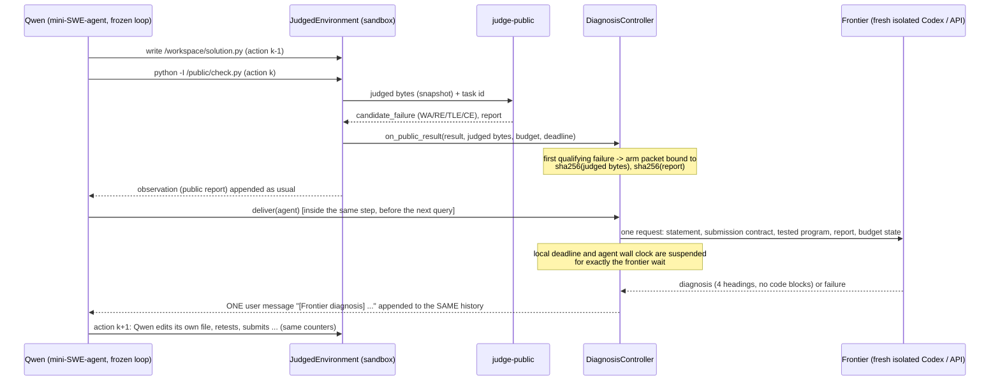

# Condition E — frontier failure diagnosis inside the running local agent

Code: `guided_agent/diagnosis.py` (trigger, evidence packet, providers, controller), plus two small hooks in
`guided_agent/backend.py`. Tests: `guided_agent/test_pass2.py`. No frozen file was changed: all 38 frozen
hashes are verified on every attempt.

## 1. Sequence

## 2. Trigger policy (exact)

`diagnosis.qualifies(result, judged_bytes)` returns true only when **all** of these hold:

* the command was the recognized public test (`TEST_PATTERN`, routed to judge-public);
* the judge status is `candidate_failure`;
* the judged candidate is non-empty;
* the first failing case's verdict is `WA`, `RE`, `TLE` or `CE`.

The judge contract (`judge/container/judge.py`) makes these candidate-caused: TLE is the candidate exceeding
the per-case time limit, while judge-side problems are a separate status, `infrastructure_error`.

Never a trigger:

* a public pass or a `MISSING` (empty) submission;
* `infrastructure_error`, which also ends the run as an infrastructure failure, exactly as in A/C/D;
* invalid shell responses, truncations or source edits, which never reach the judge;
* a later failure once the trigger has fired;
* hidden results.

The trigger fires **at most once** per attempt, on the first qualifying failure. Later failures are only
counted (`later_public_failures`). If no local action remains at the trigger, no request is made
(`error_category = no_local_budget`). A run in which Qwen never reaches a qualifying public failure is a
valid *untriggered* E run.

## 3. Evidence packet (`diagnosis.evidence_packet`)

The frontier receives only authorized public information, between nonce-delimited `DATA` markers that are
labelled as untrusted data:

* the public statement;
* a fixed submission contract (Python 3.11, stdin/stdout, `/workspace/solution.py`, line-by-line comparison);
* the **exact judged bytes**: the snapshot taken immediately before `judge.run`, so a later source version
  can never be diagnosed;
* the public report exactly as Qwen saw it, plus pass counts and the first failing case and verdict;
* the local state: actions used of 20, repair groups used of 3, local seconds remaining.

It contains no hidden tests or verdicts, no reference solutions, no other candidates, no plans or contracts,
and no other experiment records.

Size limits: program 16,000 characters and report 8,000 characters. When either is exceeded, it is clipped
head-and-tail with an explicit `[... truncated by the harness ...]` marker, and the packet records
`program_clipped` / `report_clipped`.

The packet is saved as `diagnosis/packet.json`, with sha256 of the statement, candidate, report and full user
message.

## 4. Diagnosis prompt and validation

`diagnosis-v1` (in `guided_agent/guidance.py`) asks for four headings: *Observed failure*, *Likely cause*,
*Repair direction*, *Verification target*. It forbids code blocks, replacement programs, functions and
multi-line code, permits one short inline expression, and is capped at about 250 words.

Before delivery the text is validated with the shared guidance validator: headings present, no fenced code,
no heredoc or shell writes. If validation fails, nothing is delivered (`invalid_format`); it is never
repaired, resampled or retried.

## 5. Providers (runtime callback)

| Provider | When | Isolation / accounting |
| --- | --- | --- |
| `codex` (default) | Live: a fresh `codex exec` at the moment of failure | Ephemeral session in an empty temporary directory; user config and rules ignored; read-only sandbox; web search and 12 features disabled; credential-like environment variables removed; the event stream is audited (any non-message item is an `isolation_violation`). Evidence saved per run in `diagnosis/provider/`. Labelled **Codex-authored diagnosis**; Codex harness context remains, so it is not equivalent to the API. |
| `api` | Live, paid | One reserved, write-ahead-ledgered `POST /v1/chat/completions`. No retries, `max_completion_tokens` 8,000, effort medium. Refused before sending if the ceiling would be exceeded (`budget_exhausted`). |
| `fixed` | Deterministic tests and synthetic fixtures only | Never presented as a live diagnosis |
| `replay` | Re-delivery of a recorded diagnosis | Only for the identical packet (candidate, report and statement hashes), else `replay_mismatch` |

## 6. Session continuity (what is never reset)

The controller adds exactly one message with `agent.add_messages` (`interrupt_type = FrontierDiagnosis`)
after the triggering observation. It does not touch:

* the agent object, its message history, `n_calls` or step limit;
* the sandbox container and `/workspace` (no restart, no re-copy);
* the budget object (`actions`, `repairs`, `failed_hash`, `repairing`);
* the system prompt and first message, which stay byte-identical to A.

The diagnosis does not consume a local action or repair. The next model query sees the full history,
including the original public report, which stays visible immediately before the diagnosis.

## 7. Time accounting

| Clock | Used by (frozen code) | Handling in E |
| --- | --- | --- |
| `env.deadline` (monotonic, start + 600 s) | Sandbox command timeouts, judge timeout, per-request `min(180, remaining)`, the `Deadline` limit | `+= frontier wait` |
| `agent._start_time` (`time.time`) | mini-swe-agent's `wall_time_limit_seconds = 600` (`TimeExceeded`) | `+= frontier wait` (wall clock) |
| Container lifetime (`sleep 660s`) | Docker container self-destruct | E only: `660 + max_wait + 30` (990 s by default); A/B/C/D keep 660 s |
| Outer supervisor | `run_child` hard timeout | `+ max_wait + 30` for E |

E therefore has the same 600 s of **local** opportunity as A/C/D; frontier latency is recorded separately.
The frontier call has its own timeout (300 s by default).

Recorded per attempt: `frontier_wait_seconds`, `local_coding_seconds` (end-to-end inside the agent),
`local_coding_seconds_net` (the difference), `wall_seconds`, and the remaining local seconds at the trigger.

This is an equal-local-opportunity comparison, not an equal-wall-clock one; both quantities are reported.

## 8. Recorded outcome fields (`result.json → diagnosis`)

| Field | Meaning |
| --- | --- |
| `assigned` | E was assigned |
| `trigger_observed` | A qualifying failure occurred; see also `trigger_reason`, `trigger_action`, `local_seconds_left_at_trigger` |
| `frontier_requested` | The request was attempted (consumed even if it then failed) |
| `frontier_returned` | The provider returned |
| `delivered` | The diagnosis passed validation and was delivered; see also `delivered_message_index` |
| `error_category` | One of `timeout`, `transport_error`, `isolation_violation`, `budget_exhausted`, `empty_diagnosis`, `invalid_format`, `incomplete_response`, `replay_mismatch`, `provider_error`, `no_local_budget` |
| `local_actions_after`, `public_tests_after`, `candidate_changed_after`, `public_pass_after` | Whether the diagnosis was followed by local coding, retests and a public pass |
| `observations` | Every public-test result with its trigger decision |

Hidden correctness comes from the separate evaluation, as for every condition.

## 9. Tests

`python -m unittest guided_agent.test_pass2` runs offline tests without Docker. With
`CSC2108_INTEGRATION=1`, it also runs the real frozen runtime, Docker sandbox and judge-public with a
**scripted coder** (no inference) on the synthetic fixture:

| Brief test | Test | What it asserts |
| --- | --- | --- |
| 1 Successful diagnosis/repair | `test_1_diagnosis_then_same_session_repair_passes` | Wrong code → public WA → one diagnosis (2 s fixed delay) → `sed` edits the *same* file → retest passes → submit. One continuous action counter (5). The diagnosis follows the public report. The history only grows (2→4→7→9→11 messages seen by the coder). The wait is excluded from local time. The container lifetime is 990 s. |
| 2 No trigger | `test_2_public_pass_means_no_request` | A first-time pass makes no request and adds no message |
| 3 Provider failure | `test_3_provider_failure_logged_and_agent_continues` + offline `test_provider_failures_*` | `transport_error`, `timeout`, `isolation_violation`, `budget_exhausted`, empty and invalid format (incl. a code block) are recorded; nothing is delivered and the agent continues and submits |
| 4 Judge infrastructure error | `test_4_judge_infrastructure_error_requests_nothing` | No request; the run ends as `infra_error` |
| 5 Multiple failures | `test_5_only_first_of_multiple_failures_triggers` | Trigger at the first failure only; one later failure counted; one diagnosis |
| 6 Deadline/budget continuity | `test_frontier_wait_is_excluded_from_local_time` (offline), test 1 (integration) | `env.deadline` and the agent wall clock move by exactly the wait; actions and repairs are unchanged |
| — | `test_6_a_is_unchanged_by_the_e_machinery` | A runs with the frozen 660 s container and no diagnosis fields |
| 7 Actual Codex diagnosis | `runs/dev-e`, `runs/val`, `runs/dev-s2109` | **13 live Codex E runs, 5 triggered, 5/5 delivered**, 0 tool events, 8.1–12.8 s harness wall time. Pre-trigger history byte-identical to A's. |
| 8 Direct API diagnosis | `runs/dev-e-api`, `runs/val-api` | **3 live API diagnoses** at the same frozen trigger states (identical packet hashes), all delivered; 4.4–5.7 s; $0.0055–0.0069 each; no retries |

## 10. Is E ready for full benchmarking?

**Mechanism: yes.** The trigger, delivery, continuity, accounting, provider-failure handling and records all
behave as specified on both backends, and no live run had an E provider failure.

**Decisions before the benchmark:**

1. **Provider.** Use the direct API for the main run; Codex replay carries harness context. The API cost is
   about $0.006 per triggered task.
2. **Reporting.** Report the trigger rate alongside the triggered-subset analysis, as the proposal says.
   On this agent E triggers in ~20–40% of runs: truncation prevents the public test, and easy tasks pass the
   first test.
3. **Seeds.** Use ≥3 seeds. One seed swapped E's apparent rescue for a tie (abc393_d).

**Limitation that is not an E defect.** Triggered runs are often lost to the frozen agent's
identical-rewrite loop, or to Qwen adopting a diagnosis's vocabulary but not its method (abc398_d,
arc195_a).
