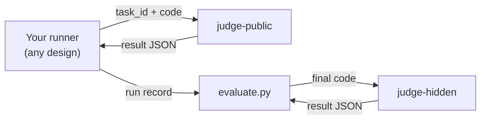
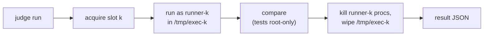

# Judge interface (draft for review)

Owner: Peter. This document specifies the judge as a black box and what the evaluation needs from each run. How the agent, its sandbox, and the orchestrator are built is up to Zhe and Sam (see [timeline/orchestration_1113.md](orchestration_1113.md)).



## 1. What the judge does

The judge takes a task ID and a submission, and returns one result. It has no state and does not know about runs, conditions, agents or repairs.

There is one image and one codebase, which run as two instances. The instances differ only in which test suite is loaded:

| Instance | Who starts it | Tests | Used for |
| --- | --- | --- | --- |
| `judge-public` | anyone | `tasks/*/tests/public` (built by `setup.sh`) | feedback during agent runs |
| `judge-hidden` | Peter only | `hidden/*` (never shared) | scoring final submissions |

## 2. Interface

The contract is the Python API below. Run `judge/setup.sh` once to build the data and the image (see `judge/README.md`).

```python
import sys; sys.path.insert(0, "<repo>/judge")
from judgekit import Judge, JudgeError

judge = Judge.public()                              # start or reuse judge-public; JudgeError if Docker is unavailable
result = judge.run("lcb-atcoder-abc393_a", code)   # code: str or bytes -> dict (schema below)
```

| Call | Behavior |
| --- | --- |
| `Judge.public()` | Starts the `judge-public` container, or reuses it if it is already running with the same image and suite. Raises `JudgeError` if Docker or the image is unavailable. |
| `judge.run(task_id, code, time_limit=None)` | Judges one submission and **always returns a result dict**. It never raises for a bad submission or a judge failure. A judge-side failure is retried once, then returned with `status: "infrastructure_error"` and an `error` field. Safe to call from several threads or processes at once. |
| `judge.info()` | Returns the judge version, suite, task IDs and the sha256 of the loaded tests. Record the sha256 if you want proof of which tests were used. |

The client uses only the Python standard library and needs a running Docker engine: Docker Desktop, OrbStack or Colima. The `python -m judgekit` command line in the README is a debugging aid and not part of the contract.

### Result

```json
{
  "judge_version": "0.2.1", "suite": "public", "task_id": "lcb-atcoder-abc393_a",
  "tests_sha256": "…", "code_sha256": "…", "time_limit_s": 6.0,
  "status": "candidate_failure",
  "passed": 1, "total": 2,
  "verdict_counts": {"AC": 1, "WA": 1},
  "cases": [{"name": "01", "verdict": "AC", "time_s": 0.03}, {"name": "02", "verdict": "WA", "time_s": 0.02}],
  "first_failure": {"name": "02", "verdict": "WA", "input": "…", "expected": "…", "actual": "…", "stderr_tail": "…"},
  "report": "PUBLIC TESTS: 1/2 passed\n…"
}
```

| Field | Meaning |
| --- | --- |
| `status` | `pass` (every case AC), `candidate_failure` (the code is wrong: WA, RE, TLE, CE, or an empty or missing submission), or `infrastructure_error` (the judge could not run the tests) |
| verdicts | `AC` accepted, `WA` wrong answer, `RE` runtime error, `TLE` time limit exceeded, `CE` syntax error, `MISSING` empty submission, `INFRA` judge-side failure |
| `report` | Bounded plain text with a summary line and the first failing case (input, expected and actual output, stderr tail, each truncated to 1000 characters). It is ready to show to an agent or to use in a diagnosis request. Use it as is, or build your own text from `first_failure`. |
| `code_sha256` | The sha256 of the submitted code, so attempts can be compared without storing the code twice |

### Execution semantics

| Item | Value |
| --- | --- |
| Submission | A standalone Python 3.12 program that reads stdin and writes stdout |
| Runtime | `python3 -I solution.py`, one process per test case |
| Time limit | 6 s wall clock per case (`task.json` `time_limit_s`) |
| Memory | 1 GiB address space |
| Output | Capped at 1 MiB |
| Network | None |
| Comparison | LiveCodeBench `grade_stdio`: the whole output and each line are stripped, the line counts must match, and each line must match exactly or as an equal list of decimals |

## 3. Requirements on runners

Only two things are required. Everything else is your design.

1. **Run all public tests through `judge-public`.** Do not use your own test runner for the feedback an agent receives. The public and hidden verdicts must come from the same code; otherwise the public–hidden gap measures a difference between test runners, not a difference in tests. Agents may still run their own code and their own tests inside their own sandbox.
2. **Hand off one run record per scheduled run** (section 4).

## 4. Run record handoff

One directory per run. The evaluation reads only these files:

```
runs/<run_id>/
  result.json       required fields below
  submission.py     final code; absent when there is no submission
  attempts.jsonl    one line per judge-public call, in order
  …                 anything else you want (trajectory, logs): ignored by evaluation
```

**`result.json`** (required fields; extra fields are kept and ignored):

| Field | Type |
| --- | --- |
| `run_id`, `task_id`, `condition` | string |
| `repeat` | int |
| `coding_model`, `guidance_model` | string or null |
| `exit_status` | `submitted`, `action_limit`, `repair_limit`, `deadline`, `agent_error`, or `infra_error` (see below) |
| `raw_exit_status` | string, the agent framework's own stop reason (for example `RepeatedFormatError`) |
| `submission_sha256` | string or null, the hash of `submission.py` |
| `n_actions`, `n_repairs` | int |
| `guidance` | `{kind, triggered, delivered, error}` |
| `usage` | `{coding: [...], guidance: [...]}`, with per-call `prompt_tokens`, `completion_tokens` and `cost_usd`. Use null when unknown, not 0. |
| `wall_seconds` | float |
| `host` | string |

**`exit_status` values.** Use exactly one per run:

| Value | Meaning |
| --- | --- |
| `submitted` | The agent ended the run with a final submission. |
| `action_limit` | The action or model-call limit was reached. |
| `repair_limit` | The repair limit was exceeded. |
| `deadline` | The wall-clock deadline was reached. |
| `agent_error` | The agent stopped itself without submitting and without hitting a limit. An example is mini-swe-agent's `RepeatedFormatError`, which occurs when the model fails the action format several times in a row. Record the framework's reason in `raw_exit_status`. |
| `infra_error` | The run failed for reasons outside the agent and the model. Examples are a judge or Docker failure, or a provider outage after retries. |

Whatever the stop reason, save the latest candidate as `submission.py` when one exists. `agent_error` is a candidate failure, not an infrastructure failure, so it stays in all metrics.

**`attempts.jsonl`**: one line per `judge-public` call, in order. Each line is `{"seq", "time", "result": <judge result JSON as returned>, "delivered": bool}`. `delivered` says whether the feedback reached the agent.

The evaluation uses this log for the following:
- Recovery rate, which is the proportion of runs that pass after a failed public attempt.
- The E trigger subset.
- Rechecking `n_repairs` against the repair rule in [timeline/orchestration_1113.md](orchestration_1113.md).

## 5. Hidden evaluation (Peter)

`evaluate.py runs/` processes each run as follows:
1. It checks `submission.py` against `submission_sha256`. A mismatch is recorded as `infrastructure_error`.
2. It sends the code to `judge-hidden` and writes `eval/<run_id>.json`.
3. A missing submission is scored as MISSING without calling the judge.

All hidden scoring runs on one machine with one judge version, so TLE verdicts are comparable across conditions.

## 6. Inside the black box (reference, not part of the contract)



- **The container is a long-lived container** started with these flags:
  - Isolation: `--network none`, read-only root, tmpfs for `/tmp` and `/var/judge`.
  - Privileges: `--cap-drop ALL --cap-add SETUID,SETGID,KILL,CHOWN,FOWNER`, `no-new-privileges`.
  - Resources: fixed `--cpus` and `--memory`.
- **Submissions cannot read the tests.** The suite is streamed into the container's tmpfs at startup with `tar | docker exec -i … tar x`. It is not bind-mounted, and is owned by root with mode 0600.
- **Each submission runs in a worker slot.** Each slot has its own unprivileged user and scratch directory, and its code is readable only by that slot, and each case runs in a fresh process group with rlimits:
  - Address space: 1 GiB
  - CPU time: time limit plus 1 s
  - File size: 16 MiB
  - Processes and threads: 4 per slot (enough for the threading recursion trick)

  After each call, all of that slot's processes are killed and its directory is wiped.
- **Container reuse is checked.** `Judge.public()` reuses a running container only if it runs the same image ID and holds exactly the requested tests; otherwise it recreates it.
- **Concurrency is limited by the slots.** The number of slots equals the container's CPU count. Calls wait for a free slot, so parallel runs do not cause false TLEs.

## 7. Open decisions

| # | Question | Proposal |
| --- | --- | --- |
| 1 | Public timing differs between members' Macs | Accept, since it only affects feedback. `host` is recorded. Hidden scoring happens on one machine. |
| 2 | Python version that agents run code with in their own sandbox | Recommend 3.12 to match the judge, so behavior is the same locally and in the judge. Not enforced. |
| 3 | `report` format | First failing case only, as now. Runners may build their own text from `first_failure`. |
| 4 | Missing submissions and infrastructure failures in metrics | As in EVALUATION_SPEC: a missing submission counts as a fail. Infrastructure failures are excluded across all conditions for that task and repeat. |
